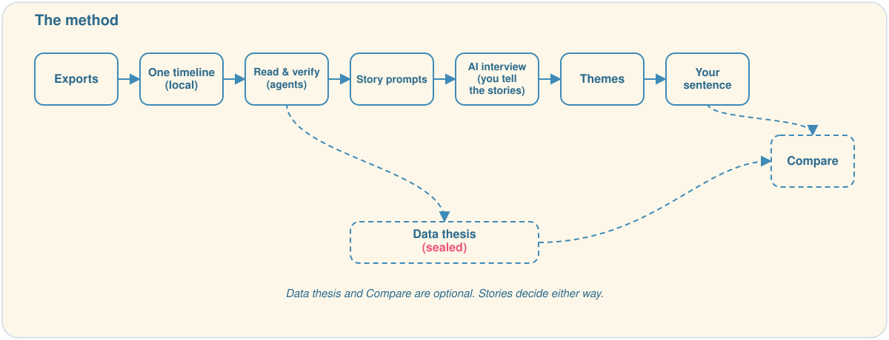
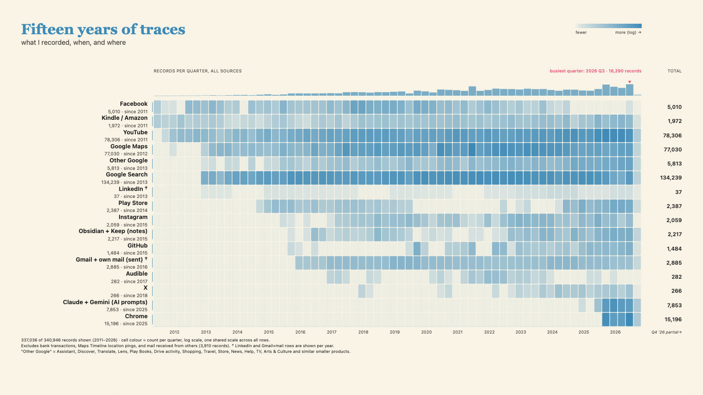

# Why from your data

A prompt kit for finding your Why, with your own data as a memory aid. No software. Stories pick your Why. Data adds, challenges or dates—it's not a Why generator, not therapy.

## What you get

- **Timeline.** Years your data covers, eras, events, blindspots.
- **20–25 story prompts.** Peaks and valleys with lines you wrote back then.
- **AI interviews.** Listen and write down your words. It asks; you speak.
- **Themes.** From stories to "To ___ so that ___". Optional sealed guess from data.

## How to start

1. **Export sources.** [SOURCES.md](SOURCES.md) has a good first set. Request now; it's slow.
2. **Make a folder** with exports in `exports/` and this kit in `kit/`. Open Claude Code.
3. **Say: "Read kit/PROMPT.md and follow it."** The agent stops at checkpoints.

## What worked

The timeline and AI interviews. Real memories came back. Friends Exercise helped. Tell many stories before the final sentence. See [FAQ.md](FAQ.md) for costs and limits.

## Privacy & ethics

What you say goes to your model provider; parsing stays on your machine. [PROMPT.md](PROMPT.md#privacy) details each phase. Share aggregates only. This can stir hard things. Talk to people you trust, not only to AI.

## Credits

Method: Simon Sinek et al., *Find Your Why* (2017). [Friends Exercise](https://simonsinek.com/uploads/books/find-your-why/find-your-why-friends-exercise.pdf).

This kit paraphrases the method. Not affiliated with the authors.

[CC BY 4.0](https://creativecommons.org/licenses/by/4.0/)
